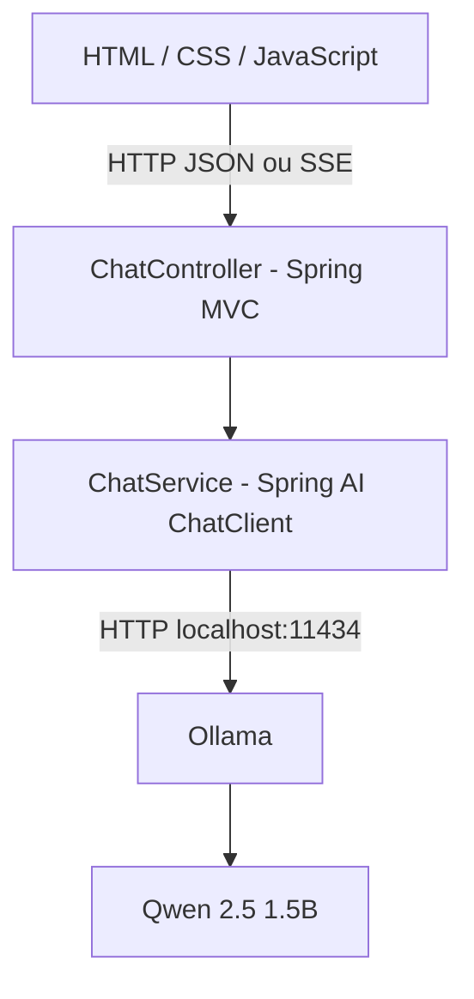

# Spring AI + Ollama Playground

Laboratório de inferência local com Java 21, Spring Boot 3.5.15, Spring AI 1.0.9, Maven, Ollama e Qwen 2.5 1.5B. Frontend HTML/CSS/JS servido pelo próprio Spring Boot. Não exige Docker, Node, banco de dados ou chave de API.

## Arquitetura



O navegador envia o prompt e os parâmetros de geração. O backend valida os limites, cria opções por requisição e consulta o modelo. O Ollama faz a inferência local. Não há treinamento nem memória de conversa neste laboratório.

## Executar no Linux Mint XFCE

1. Confira `java -version`, `mvn -version`, `ollama --version`. Use Java 21 e Maven 3.6.3 ou posterior. Se precisar de Maven: `sudo apt install maven`. Para Ollama: https://ollama.com/download/linux.
2. Verifique se Ollama está funcionando: `curl http://127.0.0.1:11434/api/tags`. Se não, inicie `ollama serve` em outro terminal (ou `sudo systemctl start ollama` se instalado como serviço). Não inicie duas instâncias na mesma porta.
3. Execute `ollama list`. Se necessário: `ollama pull qwen2.5:1.5b`.
4. Na raiz do projeto: `mvn spring-boot:run`. Selecione Java 21 no JAVA_HOME se necessário. Primeira execução precisa de internet para baixar dependências.
5. Abra http://127.0.0.1:8080 e http://127.0.0.1:8080/swagger-ui/index.html.

Para empacotar: `mvn clean package`, depois `java -Xms128m -Xmx512m -jar target/spring-ai-ollama-playground-1.0.0.jar`.

## Parâmetros

| Campo | Explicação |
|---|---|
| Temperature | Ajusta a distribuição de probabilidades; menor tende a ser mais previsível. |
| Top K | Limita candidatos aos K tokens mais prováveis. |
| Top P | Filtra candidatos pela probabilidade acumulada; interage com Top K e Temperature. |
| Max Tokens | Limite de tokens gerados, não de palavras. |
| Seed | -1 aleatória; valor fixo ajuda a repetir o experimento, sem garantia absoluta. |
| System Prompt | Orienta o comportamento; não é mecanismo de segurança. |
| numCtx | Janela de contexto fixada em 2048 tokens para economizar memória. |

## Experimentos

Mantenha o prompt `Complete a frase "O céu é" com apenas uma palavra.` e execute várias vezes. Altere uma variável por vez, com as demais constantes.

| Cenário | Temperature | Top K | Top P | Seed | Max Tokens |
|---|---:|---:|---:|---:|---:|
| Base | 0.7 | 40 | 0.9 | -1 | 32 |
| Mais previsível | 0.1 | 40 | 0.9 | -1 | 32 |
| Mais variado | 1.5 | 40 | 0.9 | -1 | 32 |
| Top K restrito | 0.7 | 1 | 0.9 | -1 | 32 |
| Top P restrito | 0.7 | 40 | 0.3 | -1 | 32 |
| Seed fixa (repita) | 0.7 | 40 | 0.9 | 42 | 32 |

As respostas podem ser iguais mesmo com opções distintas. Não há acesso aos logits reais nem probabilidades por token neste projeto. Experimente também prompts abertos como `Crie uma metáfora para o céu.`.

## API REST

```bash
curl -s http://127.0.0.1:8080/api/chat \
  -H 'Content-Type: application/json' \
  -d '{"prompt":"Complete: O céu é", "temperature":0.7,"topK":40,"topP":0.9,"maxTokens":32,"seed":42,"systemPrompt":"Responda em português."}'
```

Para streaming, use `/api/chat/stream` e acrescente `-N` ao curl. Cada evento contém um JSON com `text`, e seu tipo é `chunk`, `done` ou `error`. O modo sem streaming mostra os tokens informados pelo modelo e o tempo no servidor. Streaming mostra tempo até o primeiro trecho e tempo total no navegador. Parar interrompe a leitura no navegador; não garante cancelamento imediato de toda a inferência no servidor.

## Notebook de 8 GB

Use o modelo de 1.5B inicialmente; mantenha o contexto em 2048 e a saída em 64–128 tokens. Feche IDEs/containers desnecessários. Monitore com `free -h`, `ollama ps`, `htop` (se instalado). Se a porta 8080 estiver ocupada, altere `server.port` no application.yml. A aplicação está ligada apenas ao loopback, pois não possui autenticação e não é destinada a produção.

## Referências

- https://docs.spring.io/spring-ai/reference/1.0/api/chat/ollama-chat.html
- https://docs.spring.io/spring-ai/reference/1.0/getting-started.html
- https://ollama.com/library/qwen2.5

## Verificação

O JavaScript e o XML do Maven foram verificados sintaticamente durante a criação. A compilação Maven e a inferência não foram executadas no ambiente de geração, que não dispõe de Maven nem de Ollama.
